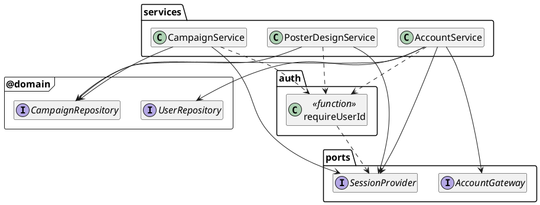
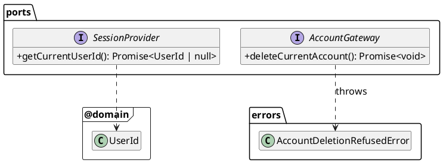
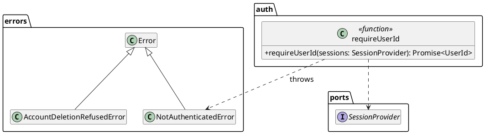
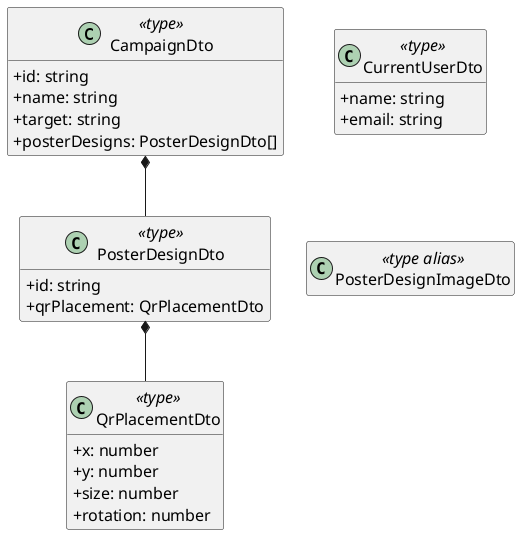
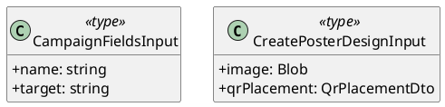
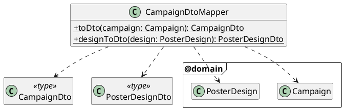
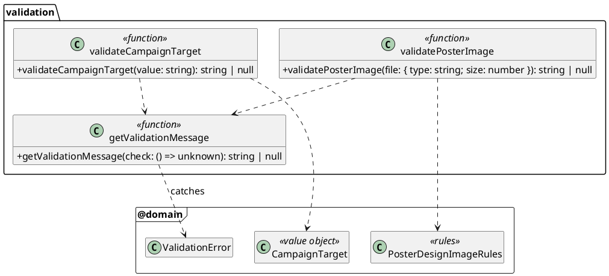
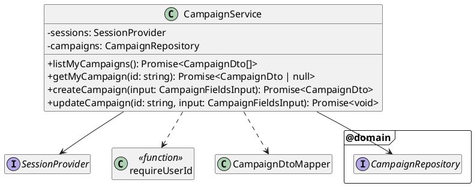
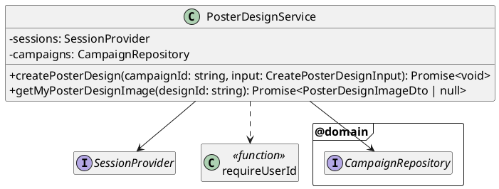
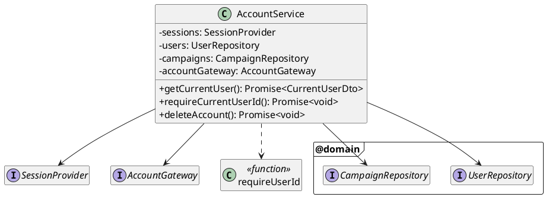

# Application Layer

Implements the use cases by orchestrating the domain and the ports. Lives in `application/` (alias `@application/*`).

**Rules**
- Imports the domain. Never imports infrastructure, Next or Better Auth.
- Declares **ports** (interfaces) for everything it needs from outside that isn't a domain repository: the session and account deletion. Email isn't a port: no use case sends email (Better Auth does, in infrastructure).
- Owner-facing use cases act as the signed-in user: **step 1** is `requireUserId`, before any validation, id parsing or repository call, and it throws `NotAuthenticatedError` if there's no session. So a signed-out request always gets `NotAuthenticatedError` (and so a sign-in redirect), whatever its input. All of today's use cases are owner-facing.
- Use cases take plain values and return plain **DTOs**, never entities. Next.js can only pass serialisable props from Server to Client Components, so class instances can't cross that boundary. A value object with no behaviour that only goes to a Route Handler may be returned as is (`PosterDesignImageDto` is an alias of the domain's `PosterDesignImageContent`).
- Server-only, with two exceptions. Every service file imports `server-only`, so a Client Component that imports one fails the build. (Tests alias `server-only` to an empty module, see [Testing](../ARCHITECTURE_REDESIGN_PLAN.md#testing).) Two folders are browser-safe and must never import it:
  - `dto/`: types only, which Client Components `import type`.
  - `validation/`: pure functions over the domain value objects, used by the forms. They must not touch ports, repositories or services.

  Anything else the browser needs (anything that reads the session or the database) goes through a Server Action. See [Validation](#validation).

## Overview
Which services depend on which ports and repositories. Members are shown in the diagram for each section below.



## Folder structure
```
application/
  ports/       SessionProvider.ts, AccountGateway.ts
  errors/      NotAuthenticatedError.ts, AccountDeletionRefusedError.ts
  auth/        requireUserId.ts
  dto/         CampaignDto.ts, PosterDesignDto.ts, CurrentUserDto.ts, PosterDesignImageDto.ts,
               inputs.ts
  mappers/     CampaignDtoMapper.ts
  validation/  getValidationMessage.ts, validateCampaignTarget.ts, validatePosterImage.ts
  services/    CampaignService.ts, PosterDesignService.ts, AccountService.ts
```

## Ports
Declared here, implemented in [infrastructure](../infrastructure/README.md), wired in [di](../dependency-injection/README.md).



### `SessionProvider`
`getCurrentUserId()` returns the signed-in user's id, or `null`. Implemented by `BetterAuthSessionProvider`, which memoises per request.

### `AccountGateway`
`deleteCurrentAccount()` deletes the signed-in user through Better Auth (which cascades to their sessions, campaigns and designs). Throws `AccountDeletionRefusedError` whenever Better Auth refuses the delete, for any reason: the session isn't fresh, the session disappeared since `requireUserId`, or deletion is disabled. This keeps today's behaviour, where the action shows the message of any `APIError`.

## Errors


### `NotAuthenticatedError`
Thrown by `requireUserId` when there's no session. Presentation turns it into `redirect(routeNames.signIn)`; redirecting is a UI concern, so it moves out of today's `requireUserId`.

### `AccountDeletionRefusedError`
Covers every refusal from Better Auth's `deleteUser`, not just a stale session. Carries Better Auth's user-facing message. Presentation shows it in the delete account dialog.

## DTOs
Plain, serialisable types. `CampaignDto` / `PosterDesignDto` replace today's `CampaignWithDesigns` / `ClientPosterDesign`; Client Components import them with `import type`.

### Outputs


- `PosterDesignDto` has no image URL: presentation builds it from `id` with `routeNames.posterDesignImage(id)`, since the route is a presentation concern.
- `PosterDesignImageDto` is `type PosterDesignImageDto = PosterDesignImageContent` (the domain's plain readonly type). Its only consumer is the image Route Handler, which passes the stream straight to `new Response`, so a copy would add nothing.

### Inputs


### `CampaignDtoMapper`


Lives in `mappers/`, not `dto/`: it's a runtime class that imports domain entities, and `dto/` holds only browser-safe types. Maps `Campaign` → `CampaignDto`, copying `QrPlacement`'s `x`, `y`, `size` and `rotation` across under the same names. Ids are the domain's UUID strings; presentation builds campaign and design image URLs from them. Blob keys never appear in a DTO.

## Validation
Browser-safe form validation, so the forms can show errors as the user types. The forms check one field at a time (the target on each change, the image when it's picked), so there's one function per validated field. Each returns that field's user-facing message, or `null`, and never throws a `ValidationError`.



### `getValidationMessage`
Runs `check` and returns `null` if it passes, or the message if it throws a `ValidationError`. Any other error is rethrown. It's the one place that turns the domain's throwing factories into messages for the forms.

### `validateCampaignTarget` / `validatePosterImage`
Replace the client-side uses of today's `getTargetError` and `getImageFileError`:
- `validateCampaignTarget(value)` runs `CampaignTarget.create(value)`. The name has no rules today, so it has no validator.
- `validatePosterImage({ type, size })` runs `PosterDesignImageRules.assertValid`, so the form can check a picked file before uploading it.

The QR fields have no validator, as today: their inputs are constrained by `min`/`max`/`step` attributes read from `QrPlacement.RANGES` (see [`QrPlacement`](../domain/README.md#qrplacement)).

The services don't call these functions. They call the domain factories directly, which throw `ValidationError`. Because the factories hold the rules, the forms and the services can't drift apart.

### What doesn't go here
A check that needs the database or session isn't pure, so it belongs in a service, and the form calls it through a Server Action.

## Services
One class per area; each public method is a use case. Constructor injection only: no service calls `new` on a dependency.

### `CampaignService`


Every use case starts with `requireUserId` (see [Rules](#application-layer)).

| Use case | Replaces | Steps |
|---|---|---|
| `listMyCampaigns()` | `getMyCampaigns` | `requireUserId` → `findAllByOwner` → map to DTOs. |
| `getMyCampaign(id)` | `getMyCampaign` | `requireUserId` → `CampaignId.parse(id)` (not a UUID → `null`) → `findByIdForOwner` → DTO or `null`. |
| `createCampaign(input)` | `createCampaign` | `requireUserId` → `CampaignTarget.create` → `Campaign.create(userId, name, target)` (generates the id) → `add` → DTO (the action redirects to its id). |
| `updateCampaign(id, input)` | `updateCampaign` | `requireUserId` → `CampaignId.parse` and load with `findByIdForOwner` (either fails → `NotFoundError`) → `campaign.updateDetails` → `campaigns.updateDetails`. |

### `PosterDesignService`


| Use case | Replaces | Steps |
|---|---|---|
| `createPosterDesign(campaignId, input)` | `createPosterDesign` | `requireUserId` → `QrPlacement.create(input.qrPlacement)` and `PosterDesignImageUpload.create(input.image, input.image.type)` (validates before any storage) → `CampaignId.parse` and load with `findByIdForOwner` (either fails → `NotFoundError`) → `campaign.addDesign(qrPlacement)` (generates the design id) → `campaigns.addDesign(campaign, design, image)`. |
| `getMyPosterDesignImage(designId)` | `getMyPosterDesignImageKey` + `getImage` | `requireUserId` → `PosterDesignId.parse` (not a UUID → `null`) → `findDesignImageForOwner`. |

### `AccountService`


| Use case | Replaces | Steps |
|---|---|---|
| `getCurrentUser()` | `getCurrentUser` | `requireUserId` → `users.findById` → `{ name, email }`. Throws if the user is missing. |
| `requireCurrentUserId()` | `requireUserId` (as a guard) | Throws `NotAuthenticatedError` if signed out. Used by `(app)/layout.tsx`. |
| `deleteAccount()` | `deleteCurrentUser` | See below. |

`deleteAccount()` starts with `requireUserId`, then keeps today's ordering, so a rejected delete leaves the account intact:
1. `campaigns.findAllDesignImageRefsByOwner(userId)`. Read first, because deleting the user cascades to the designs, which hold the images' blob keys.
2. `accountGateway.deleteCurrentAccount()`. Throws `AccountDeletionRefusedError` if Better Auth refuses (for example, the session isn't fresh).
3. `campaigns.deleteDesignImages(refs)`.

If step 3 fails, or the process dies between steps 2 and 3, the orphaned images are accepted for now, as today. A clean-up job can be added if needed.

## Not in this layer
Sign up, sign in (email / Google), sign out, request password reset and reset password are owned by Better Auth and called from the browser through its client (see [presentation](../presentation/README.md#better-auth-exceptions)). There's no business logic in them to put here.

## Tests
Real services with in-memory fakes: `InMemoryCampaignRepository`, `InMemoryUserRepository`, `FakeSessionProvider`, `FakeAccountGateway`. The repository fake must behave like the Drizzle one: `updateDetails` copies only the name and target (never the designs), and `addDesign` throws if the design isn't in `campaign.getDesigns()`. Otherwise a use case that edits a design and calls `updateDetails` would pass against the fake and silently do nothing in production. Cover ownership (`NotFoundError` for other users' data), `null` / `NotFoundError` for ids that aren't UUIDs, `NotAuthenticatedError` when signed out (including with invalid input or a non-UUID id, since the session check comes first), validation before storage, and the account deletion ordering. The `validation/` functions get plain unit tests with no fakes.
