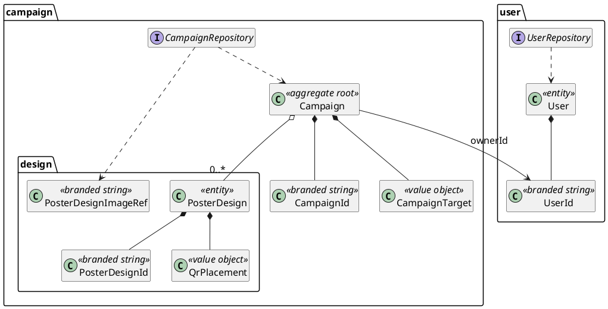
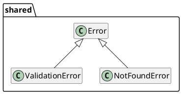
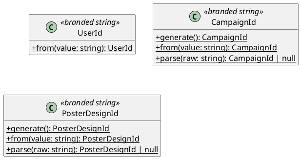
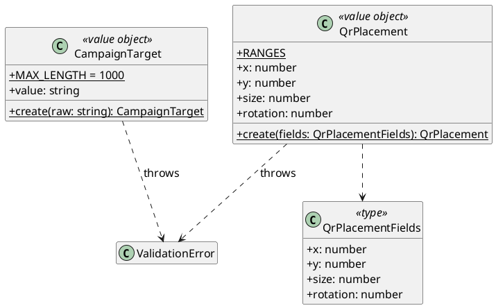
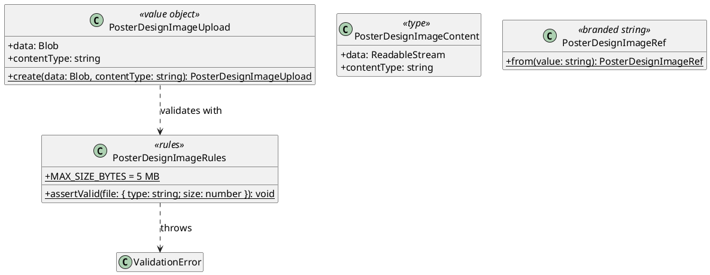
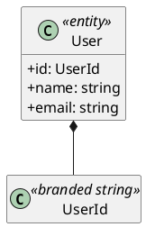
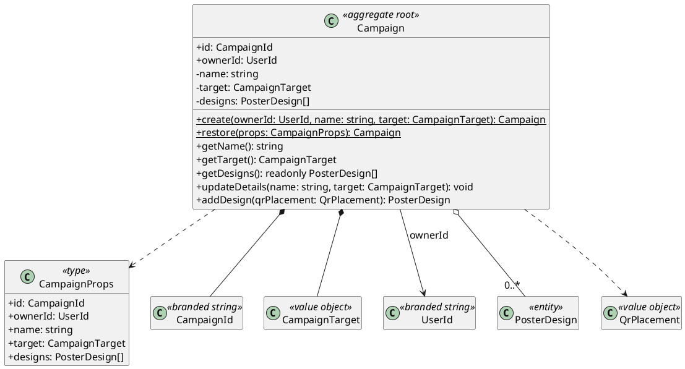
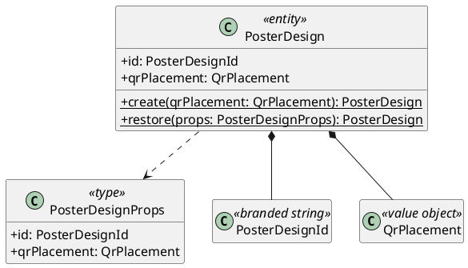
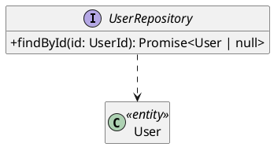
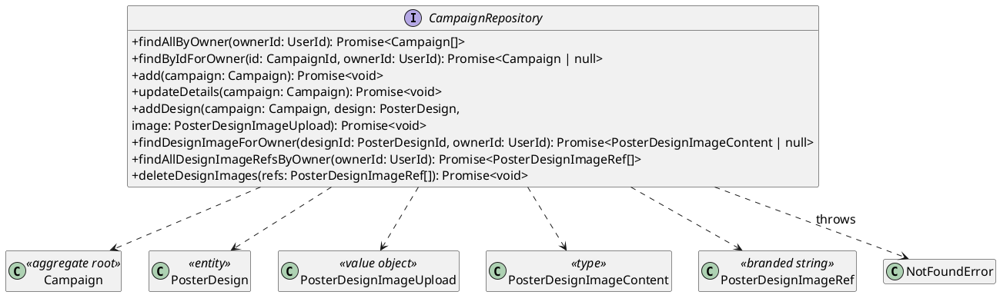

# Domain Layer

The core business entities and rules of Poster Trace. Lives in `domain/` (alias `@domain/*`).

**Rules**
- Imports nothing from the other layers, and no frameworks (no Drizzle, Next, Better Auth, Netlify).
- Never imports `server-only`. The value objects' validation rules also run in the browser (through [application validation](../application/README.md#validation)), so every file must be safe to bundle for the browser.
- Repository **interfaces** live here; their implementations live in [infrastructure](../infrastructure/README.md).
- **The domain assigns its own ids.** Campaigns and designs get a UUID when they're created in memory (`Campaign.create`, `Campaign.addDesign`), before anything is saved, so the database never has to assign one. The one exception is `UserId`: users belong to Better Auth, which assigns their ids, and the domain only refers to them. (`PosterDesignImageRef` isn't an id: it's an opaque reference that infrastructure creates, see [Poster design images](#poster-design-images).)
- There is no authentication service and there are no password rules here. The domain only knows *who* a user is (`UserId`) and *what they own*. Authentication is a generic subdomain handled by Better Auth (see [application ports](../application/README.md#ports)).

## Overview
How the domain types relate. Members are shown in the diagram for each section below.

**Glossary:** the core concept is a **Campaign**, everywhere: the aggregate (`Campaign`), its repository (`CampaignRepository`), the services, DTOs, routes and the `campaign` table. "Poster campaign" isn't used in code.



## Folder structure
```
domain/
  shared/            ValidationError.ts, NotFoundError.ts, uuid.ts
  user/              User.ts, UserId.ts, UserRepository.ts
  campaign/          Campaign.ts, CampaignId.ts, CampaignTarget.ts,
                     CampaignRepository.ts
  campaign/design/   PosterDesign.ts, PosterDesignId.ts, QrPlacement.ts,
                     PosterDesignImageRules.ts, PosterDesignImageUpload.ts,
                     PosterDesignImageContent.ts, PosterDesignImageRef.ts
```

## Scope
Only today's features are modelled. `Poster` and `PosterScan` tables exist (and the seed script fills them), but no feature uses them, so they get no entities or repositories until a use case needs them.

## Errors


### `ValidationError`
Thrown when input breaks a domain rule. The message is user-facing (e.g. "The target URL is too long…"), as today's `validateCampaignFields` messages are.

### `NotFoundError`
Thrown for "doesn't exist" **and** "owned by someone else", so ids can't be used to probe other users' data.

## Value objects
Ids are branded primitives (below). `PosterDesignImageContent` is a plain readonly type, as it has no rules (see [Poster design images](#poster-design-images)). Every other value object is an immutable class with a private constructor and a static factory that validates (throwing `ValidationError`). The factory is the only way to check a value: forms validate through [application validation](../application/README.md#validation), which calls it and catches `ValidationError`, whose message is shown to the user.

**Stored values go through the same factories.** Repositories rebuild entities from stored rows with the validating factories (there's no separate non-validating path), so a stored value that breaks a rule surfaces as an error. This is an accepted risk: if a rule is tightened later (target length, URL schemes, QR ranges), the stored data must be checked or migrated at the same time, or the affected rows (and every page that loads them) fail to load.

### Ids (`UserId`, `CampaignId`, `PosterDesignId`)


Each id is a primitive with a compile-time-only brand, plus a same-named factory object:

```ts
export type CampaignId = string & { readonly __brand: "CampaignId" };
export const CampaignId = {
  generate(): CampaignId {
    return crypto.randomUUID() as CampaignId;
  },
  from(value: string): CampaignId {
    if (!isUuid(value)) throw new ValidationError("Invalid campaign id");
    return value as CampaignId;
  },
  parse(raw: string): CampaignId | null {
    return isUuid(raw) ? (raw as CampaignId) : null;
  },
};
```

- **Why branded:** every id is a string, and TypeScript compares types by shape, so without a brand any id (or any string) would be accepted where another is expected. The brand makes each kind of id a distinct type, so they can't be mixed up.
- **Why not classes:** at runtime an id is just the string, so it can go into Drizzle queries, URLs and JSON, and across the Server/Client Component boundary, without unwrapping. Ids are compared with `===`.
- **The `as` rule:** `as XxxId` appears only inside that id's `generate`/`from`/`parse`, so every id was either generated or has passed validation.

`CampaignId` and `PosterDesignId` are UUIDs:
- `generate()` uses `crypto.randomUUID()`, a web standard available in Node and the browser, so the domain needs no library. These are random (v4) UUIDs, which is fine as primary keys at this app's scale. If index locality ever matters, `generate()` is the one place to switch to time-ordered v7 UUIDs.
- `from` rejects anything that isn't a UUID (`isUuid` in `shared/uuid.ts`).
- `parse(raw)` is for ids arriving as URL segments (the campaign pages and the image route). It returns `null` for anything that isn't a UUID, so a bad URL is a 404 rather than an error.

`UserId` brands Better Auth's text id, and has no `generate`, because the domain never creates users. Its `from` rejects empty strings.

### `CampaignTarget` and `QrPlacement`


#### `CampaignTarget`
Replaces `src/data/campaignValidation.ts`. `create(raw)` trims the value, then runs today's `getTargetError` checks (empty, over `MAX_LENGTH` UTF-8 bytes, not a parseable URL, not http/https), throwing `ValidationError` with the same messages.

#### `QrPlacement`
Replaces the QR half of `src/data/posterDesignValidation.ts`.
- `QrPlacementFields` is the plain input to `create`: `{ x, y, size, rotation }`, all numbers.
- `RANGES` holds today's `QR_RANGES` values, keyed by the `QrPlacement` names: `RANGES.x`, `RANGES.y`, `RANGES.size`, `RANGES.rotation`, each `{ min, max, step }`.
- **`x`, `y`, `size` and `rotation` are the names in every layer:** the DTOs (`PosterDesignDto.qrPlacement`), the create input, the form's input names, the drawing code and the `poster_design` columns. Today's `qrXPosition`, `qrYPosition`, `qrSize` and `qrRotation` are renamed everywhere, so no layer translates between names, and the form's inputs read `RANGES[name]` directly.
- `create` rejects any non-finite or out-of-range value. The upper limit of `size` depends on the image, so it's only enforced by the form, as today.

### Poster design images


#### `PosterDesignImageRules`
Replaces `getImageFileError`. `assertValid` takes `{ type, size }` rather than a `File`, so the domain doesn't depend on browser or Node file types, and the form can check a picked file before uploading it. It throws `ValidationError` for non-`image/*` types, empty files ("A poster image is required") and files over 5 MB.

#### `PosterDesignImageUpload` / `PosterDesignImageContent`
The image going into, and coming out of, the repository.
- `PosterDesignImageUpload.create(data, contentType)` runs `PosterDesignImageRules.assertValid` on `{ type: contentType, size: data.size }`. The validated `contentType` is what gets stored: the repository passes it to the blob store explicitly, rather than the store reading `data.type` (see [`BlobStore`](../infrastructure/README.md#blobstore--netlifyblobstore)).
- `PosterDesignImageContent` is a plain readonly type (`{ readonly data: ReadableStream; readonly contentType: string }`), not a class. It has no rules to enforce, so infrastructure builds it as an object literal. The application's `PosterDesignImageDto` is a type alias of it.

#### `PosterDesignImageRef`
An opaque, branded reference to a stored image: in practice the blob key, which infrastructure generates. The domain never creates, parses or interprets one; it only passes the refs it was given back to the repository, during account deletion (see [`CampaignRepository`](#campaignrepository)). `from` rejects empty strings, and only infrastructure calls it.

## Entities
### `User`


Read-only in this system: users are created and deleted by Better Auth, so `UserRepository` has no `save`/`delete`.

### `Campaign` (aggregate root)


Owns its `PosterDesign`s. Every read loads the designs with the campaign, since every page shows them together.
- `create` makes a brand-new campaign with a generated `CampaignId` and no designs. It's complete before it's saved, so the repository just stores it.
- `restore` rebuilds a campaign that's already stored, from `CampaignProps` (`id`, `ownerId`, `name`, `target`, `designs`, already validated). Only repositories call it, and it generates nothing.
- `updateDetails` changes the name and target.
- `addDesign` creates a `PosterDesign` (generating its `PosterDesignId`), appends it and returns it, so the caller can save it with its image.

The constructor is private, so these two factories are the only ways to get a campaign.

Ownership isn't checked by the aggregate: it's enforced by the repository's owner-scoped reads and writes (see [Repositories](#repositories)).

### `PosterDesign`


An entity inside the `Campaign` aggregate. Its image isn't a separate entity and has no id: it's stored with the design and fetched by the design's id (`findDesignImageForOwner`).
- `create` generates the id. Only `Campaign.addDesign` calls it, so a design always belongs to a campaign.
- `restore` is for repositories, as on `Campaign`, and takes `PosterDesignProps` (`id`, `qrPlacement`).

## Repositories
One repository per aggregate root. Repositories take and return domain entities, never Drizzle rows, and never assign ids: they store the ids the domain generated. Repositories never read the session. Owner-facing reads take an explicit `ownerId: UserId`. Writes use the `ownerId` of the campaign passed in, which was loaded for that owner.

**Designs are persisted only through design-specific methods** (today just `addDesign`). `updateDetails` saves the campaign's own fields and never writes its designs, so a future use case that changes a design needs its own repository method. **Rule for new use cases:** every new aggregate mutation needs a matching repository method, plus a test against the in-memory fake that fails if `updateDetails` is used instead.

**Image methods are a deliberate exception.** `findDesignImageForOwner`, `findAllDesignImageRefsByOwner` and `deleteDesignImages` read or delete image content rather than persist the aggregate. They're kept on `CampaignRepository` as a pragmatic choice: the images belong to the campaign's designs, and a separate image repository would add a type and wiring for three methods.

### `UserRepository`


`findById` only.

### `CampaignRepository`


| Method | Notes |
|---|---|
| `findAllByOwner` | Includes designs. |
| `findByIdForOwner` | Includes designs. `null` if missing or not owned. Used by the campaign pages and the commands. |
| `add` | Inserts a campaign made by `Campaign.create`, with its generated id. |
| `updateDetails` | Saves the name and target only; never the designs. Throws `NotFoundError` if the campaign isn't owned by its `ownerId`. |
| `addDesign` | Stores a design returned by `campaign.addDesign`, along with its image, under the design's generated id. Throws if `design` isn't in `campaign.getDesigns()` (a programming error), and `NotFoundError` if the campaign isn't owned by its `ownerId`. |
| `findDesignImageForOwner` | Ownership is checked through the design's campaign. `null` if missing or not owned. |
| `findAllDesignImageRefsByOwner` / `deleteDesignImages` | Used only by account deletion (see [`AccountService`](../application/README.md#accountservice)). |

## Tests
Plain unit tests with no fakes: value object rules (moving today's validation cases across), id parsing, and entity behaviour (including that `create` and `addDesign` generate fresh ids).
