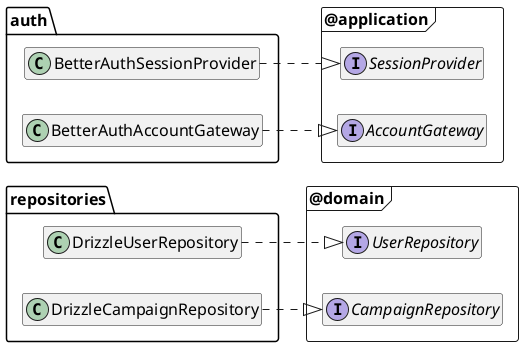
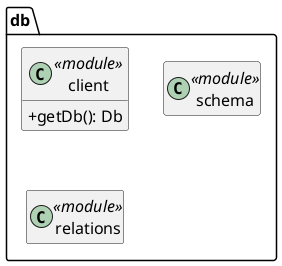
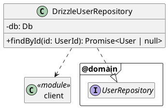
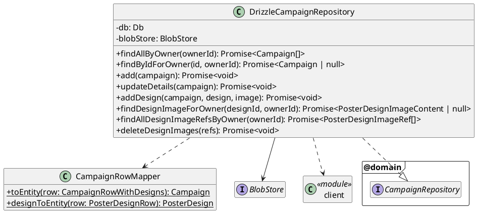
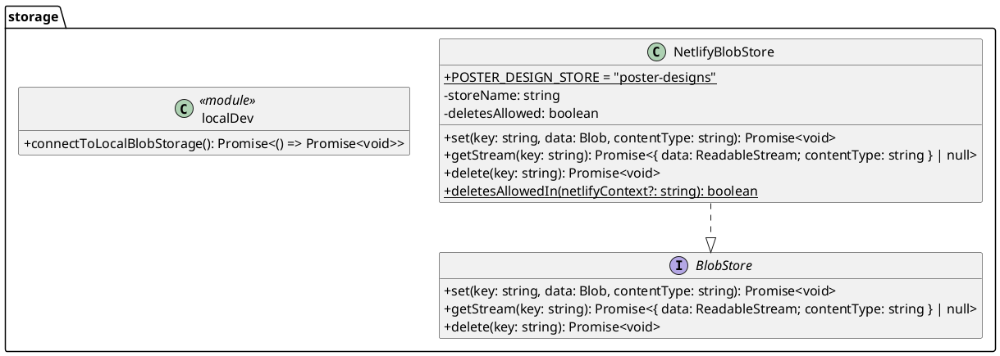
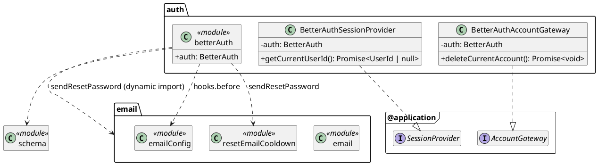
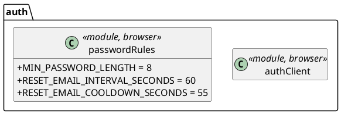
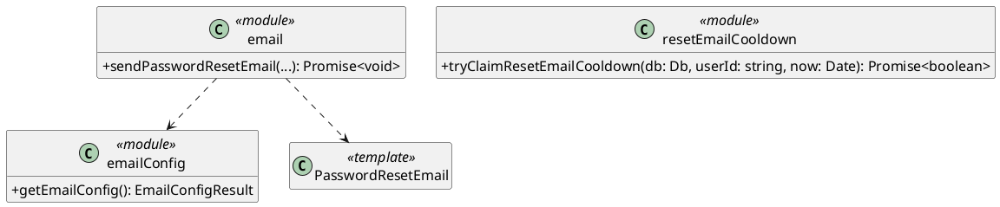

# Infrastructure Layer

Implements the domain repositories and the application ports against Postgres (Drizzle), Netlify Blobs, Better Auth and Resend. Lives in `infrastructure/` (alias `@infrastructure/*`).

**Rules**
- Implements interfaces from domain (repositories) and application (ports). Never imports presentation or di.
- In the app, only [di](../dependency-injection/README.md) constructs these classes. Presentation imports infrastructure only for the [Better Auth exceptions](../presentation/README.md#better-auth-exceptions). Outside the app, `scripts/` (the seed) and `tests/` may import and construct infrastructure directly.
- Nothing connects to a service at import time (`next build` imports these modules without credentials).

## Overview
Which infrastructure class implements which domain or application interface. Members are shown in the diagram for each section below.



The email module and `tryClaimResetEmailCooldown` (see [Email](#email)) implement no interface: only the Better Auth config uses them. `BlobStore` (see [Storage](#storage)) is an infrastructure-internal interface, not a domain one.

## Folder structure
```
infrastructure/
  db/             client.ts (today's src/db/index.ts), schema.ts, relations.ts
  repositories/   DrizzleUserRepository.ts, DrizzleCampaignRepository.ts,
                  CampaignRowMapper.ts
  storage/        BlobStore.ts, NetlifyBlobStore.ts, localDev.ts
  auth/           betterAuth.ts, BetterAuthSessionProvider.ts, BetterAuthAccountGateway.ts,
                  authClient.ts, passwordRules.ts
  email/          index.ts, resetEmailCooldown.ts, emailConfig.ts, templates/
```

Two tooling configs point at files that move, and are updated with them:
- `drizzle.config.ts`: `schema: "./infrastructure/db/schema.ts"` (was `./src/db/schema.ts`).
- `package.json` `email:dev`: `email dev --dir infrastructure/email/templates` (was `src/email/templates`).

## Schema changes
### Ids
The domain generates every campaign and design id (see [domain ids](../domain/README.md#ids-userid-campaignid-posterdesignid)), so the database stops assigning them. Each `serial` key becomes a Postgres `uuid` column with **no default**. An insert without an id then fails instead of the database quietly making one up.
```
campaign                                          -- was poster_campaign
  id                  uuid  primary key           -- CampaignId (was serial)
  created_at          timestamp not null default now()

poster_design
  id                  uuid  primary key           -- PosterDesignId (was serial)
  campaign_id         uuid  not null references campaign(id) on delete cascade
                                                  -- was poster_campaign_id
  design_image_key    text  not null              -- unchanged; the blob key
  x, y, size, rotation  double precision not null -- was qr_x_position, qr_y_position,
                                                  -- qr_size, qr_rotation
  created_at          timestamp not null default now()

poster
  poster_design_id    uuid  not null references poster_design(id) on delete cascade
                                                  -- was integer, to follow the design key
```
`created_at` is new on `campaign` and `poster_design`. Today's lists have no `ORDER BY` and come back in insertion order more or less by accident. Random UUIDs don't sort by age, so `findAllByOwner` orders campaigns, and each campaign's designs, by `created_at` to keep today's order.

**Names follow the domain** (see the [glossary](../domain/README.md#overview) and [`QrPlacement`](../domain/README.md#qrplacement)). `poster_campaign` becomes `campaign`, and the QR columns become `x`, `y`, `size` and `rotation`. The Drizzle exports and relations are renamed with them: `posterCampaign` → `campaign`, `posterDesign.posterCampaignId` → `campaignId`, and `user.posterCampaigns` → `user.campaigns`. Today's exported row types (`PosterCampaign`, `PosterDesign`) are deleted: presentation uses DTOs instead.

`poster` and `scan` aren't modelled and keep their `serial` / `integer` keys. Only `poster.poster_design_id` changes, because it references the design key. A feature that models them chooses their keys in its own migration.

Better Auth's tables keep their text ids, which Better Auth assigns.

### Images
Unchanged from today. `poster_design.design_image_key` holds the blob key, which infrastructure generates (`crypto.randomUUID()`), and the content type stays in the blob's metadata (now the content type the domain validated, passed explicitly; see [`BlobStore`](#blobstore--netlifyblobstore)). The key reaches the domain only as an opaque [`PosterDesignImageRef`](../domain/README.md#posterdesignimageref), during account deletion.

Better Auth's Drizzle adapter finds `user`, `session`, `account`, `verification` and `rate_limit` by export name, so those exports keep their names.

### Migration
Update `schema.ts`, then `npm run db:generate`. The generated migration **can't be used as is**: drizzle-kit turns `serial` → `uuid` into `ALTER COLUMN "id" SET DATA TYPE uuid USING "id"::uuid`, and Postgres has no integer → uuid cast, so it fails even on empty tables (and so on `db:reset`, which replays the baseline migration first).

Hand-edit the generated migration to drop and recreate the four poster tables instead: drop `scan`, `poster`, `poster_design` and `poster_campaign` (in that order, for the foreign keys), then create `campaign`, `poster_design`, `poster` and `scan` with the new schema. (When `db:generate` asks whether `campaign` is a rename of `poster_campaign`, answer that it's a new table; the statements are replaced anyway.) Better Auth's tables and `password_reset_email` aren't touched.

Netlify applies committed migrations on every deploy, so this **discards all existing poster data in every hosted database**: production, and each deploy preview's database branch when its deploy applies the migration. Users and their sign-ins survive; their campaigns and designs don't. The blobs those designs pointed to are left in the site-wide store as orphans, which is accepted, as for account deletion.

**No rollback past this migration.** Netlify's "publish previous deploy" doesn't roll back migrations. Once this migration is applied to production, a deploy from before it can't work against the new schema: creating a campaign fails (the old insert sends no id to a `uuid` key with no default), and every campaign and image URL is a 404 (the old code expects integer ids). Fixes after this migration must roll forward.

Locally, `npm run db:reset` then `npm run seed` gives a clean database.

## `db/client.ts`


Today's `src/db/index.ts`: the lazy Proxy, the `globalThis` reuse across hot reloads, the connection-free schema metadata for Better Auth, and the Neon HTTP compatibility shim all stay. It exports the `Db` type and `getDb()`, which **returns the lazy Proxy** (with its `_` metadata fallback), not a connected client. Today's internal function that's also called `getDb()` connects eagerly (`getDatabase()` throws without `NETLIFY_DB_URL`), so it's renamed and stays private. Calling the exported `getDb()` never connects, so `betterAuth.ts` and di can use it at import time without breaking `next build`.

## Repositories
### `DrizzleUserRepository`


Only reads the `user` table; Better Auth creates and deletes users.

### `DrizzleCampaignRepository`


Every owner-scoped query filters on `campaign.user_id = ownerId` (designs and images through their campaign), so other users' data looks missing.
No method generates an id: every insert writes the id already on the entity.
- **`findAllByOwner` / `findByIdForOwner`**: one relational query each, with designs (without their image keys), ordered by `created_at`. Mapped to entities by `CampaignRowMapper`.
- **`add`**: `INSERT` of `campaign.id`, `ownerId`, name and target.
- **`updateDetails`**: `UPDATE` name and target `WHERE id = campaign.id AND user_id = campaign.ownerId`. Never writes designs. No row updated → `NotFoundError`.
- **`addDesign`**:
  1. Throws if `design` isn't in `campaign.getDesigns()`.
  2. Checks `campaign.id` is owned by `campaign.ownerId` (else `NotFoundError`).
  3. Writes the blob with `blobStore.set(key, image.data, image.contentType)`, under a new key (`crypto.randomUUID()`, as today's `saveImage`). The key is infrastructure's own; it isn't the design id.
  4. Inserts the `poster_design` row (`design.id`, `x`, `y`, `size`, `rotation`, `design_image_key`).
  5. If the insert fails, deletes the blob (today's clean-up in `src/data/posterDesigns.ts`).
- **`findDesignImageForOwner`**: joins design → campaign by owner to read `design_image_key`, then streams the blob from the `BlobStore` with the content type from its metadata, as today. Returns it as a `PosterDesignImageContent` object literal (a plain type in the domain).
- **`findAllDesignImageRefsByOwner`**: reads `design_image_key` for every design of the owner's campaigns, wrapped with `PosterDesignImageRef.from`.
- **`deleteDesignImages`**: deletes each blob.

### `CampaignRowMapper`
Drizzle rows → domain entities, through `Campaign.restore(CampaignProps)` and `PosterDesign.restore(PosterDesignProps)` (never `create`, which would generate new ids). The `x`, `y`, `size` and `rotation` columns go straight into `QrPlacement.create`, with no renaming. Values go through the domain factories (`CampaignId.from`, `CampaignTarget.create`, …), so a stored invalid value surfaces as an error rather than a silently invalid entity. There's deliberately no non-validating path: tightening a domain rule later means checking or migrating the stored data at the same time (see [domain value objects](../domain/README.md#value-objects)).

## Storage


### `BlobStore` / `NetlifyBlobStore`
Today's `src/imageStorage`, as an infrastructure-internal interface and class. `DrizzleCampaignRepository` depends on the `BlobStore` interface, so tests can pass a plain fake. `NetlifyBlobStore` implements it. Neither is a domain interface.
- **Store:** a strongly consistent, site-wide store. Its name is the exported constant `NetlifyBlobStore.POSTER_DESIGN_STORE`, shared by di and the seed.
- **Store lookup:** `getStore({ name, consistency: "strong" })` is called inside each of `set`, `getStream` and `delete`, as today, and never cached in the constructor. `getStore()` copies the Blobs site id and token from the environment when called, and di builds the class once per process, so caching it would reuse the first request's credentials.
- **Content type:** `set(key, data, contentType)` stores the `contentType` it's given in the blob's metadata. That's the value the domain validated in `PosterDesignImageUpload`, not `data.type`. `getStream` returns it with the stream.
- **Delete rule:** keeps today's rule that only production and local dev delete blobs, because deploy previews have their own database branch but share the store. Locally, `NETLIFY_CONTEXT` is `"dev"` under `netlify dev`, but `""` under plain `next dev` or a local `next build` (`next.config.mjs` inlines `process.env.CONTEXT ?? ""`). So the rule is exactly today's:
  ```ts
  static deletesAllowedIn(ctx?: string) {
    return !ctx || ctx === "production" || ctx === "dev";
  }
  ```
  It's evaluated in di and passed in as `deletesAllowed`, so it's testable. When deletes aren't allowed, `delete` returns without deleting.
- Not marked `server-only`, as the seed script uses it.

### `localDev.ts`
Today's `connectToLocalImageStorage`, for the seed script.

## Auth
Server side:


Browser side:


### `betterAuth.ts`
Today's `src/auth/auth.ts`, moved. It still exports a **module-level `auth`**: today's `betterAuth()` config unchanged (Drizzle adapter, Google, OAuth proxy, database rate limit with the `ipAddressHeaders`, `after`-based background tasks, `revokeSessionsOnPasswordReset`, `deleteUser`, `hooks.before` using `getEmailConfig()`), except that `sendResetPassword` calls `tryClaimResetEmailCooldown(db, user.id, new Date())`, returns if it's `false`, and otherwise does `await import("../email")` and calls `sendPasswordResetEmail`, as today.

This is a deliberate exception to the DI rule against module-level singletons (see [di](../dependency-injection/README.md)). The module is already build-safe: `db` is the lazy Proxy from [`getDb()`](#dbclientts) (which Better Auth's adapter needs, as it reads `db._` on construction), and Resend loads only on first send. No test needs to inject into the config, so a factory would add code for nothing.

Better Auth's per-IP rate limit (`rateLimit` + the `rate_limit` table) stays entirely in this config.

### `BetterAuthSessionProvider`
Wraps `auth.api.getSession({ headers: await headers() })`, memoised with React `cache()` so each request does one lookup, as today. Returns `UserId | null`.

### `BetterAuthAccountGateway`
Wraps `auth.api.deleteUser({ body: {}, headers })`. Translates **every** `APIError` it throws into `AccountDeletionRefusedError` with its message: a stale session (`SESSION_EXPIRED`), a session that disappeared since `requireUserId`, or deletion being disabled. That matches today's action, which shows the message of any `APIError`. Other errors propagate.

### `authClient.ts`
Today's `src/auth/auth-client.ts`: the Better Auth browser client. It also re-exports the `BetterFetchOption` type from `better-auth/react`, so `SocialSignOn` imports it from here rather than from `better-auth` directly.

### `passwordRules.ts`
Today's `src/auth/passwordRules.ts`. Auth configuration rather than business rules: `MIN_PASSWORD_LENGTH` mirrors Better Auth's `minPasswordLength`, and `RESET_EMAIL_INTERVAL_SECONDS` is tied to Better Auth's 3-per-60-seconds limit, with the cooldown derived from it. Bundled for the browser, so it must stay free of server-only imports.

## Email


### `email/index.ts`
Today's `src/email/index.ts`, moved unchanged: a function module exporting `sendPasswordResetEmail`. `betterAuth.ts` loads it with `await import("../email")` inside `sendResetPassword`, as today, so Resend and the templates aren't loaded by every request that touches auth.

### `resetEmailCooldown.ts`
`tryClaimResetEmailCooldown(db, userId, now)` is today's **single atomic upsert** on `password_reset_email`, moved out of `auth.ts` unchanged: at most one reset email per account per `RESET_EMAIL_COOLDOWN_SECONDS`, using `setWhere sent_at < now - cooldown`, so concurrent requests send exactly one email and skipped requests don't move the timestamp. Returns whether this request claimed the send. `userId` is Better Auth's raw id.

### `emailConfig.ts`
Today's `src/email/config.ts`.

## Tests
Against a test Postgres (a `netlify database` branch or a local container):
- Drizzle repositories, with an in-memory fake `BlobStore`. Cover owner scoping, that the blob is stored with the upload's validated `contentType`, that saved rows keep the domain's ids, `created_at` ordering, that `updateDetails` writes only name and target, that `addDesign` rejects a design not in the campaign, `addDesign` rollback, and that `findAllDesignImageRefsByOwner` returns the keys to delete.
- `tryClaimResetEmailCooldown` concurrency (of several concurrent claims, exactly one wins) and that a skipped claim doesn't move the timestamp.

Without a database:
- `NetlifyBlobStore.deletesAllowedIn`: `true` for `""`, `undefined`, `"dev"` and `"production"`; `false` for `"deploy-preview"` and `"branch-deploy"`.
